# 小驴常用（内测版）

> **本地未发布修复（R238）**：发现多块正文完整性缺陷后，新建、正文更新和导入暂仅接受单行内容或一个完整代码围栏。当前示例包共 25 条，其中 8 条（原有 3 条加上邮箱、地址、无效身份占位、网址和代码入门 5 条安全示例）符合限制，17 条原多行模板会拒绝。完整简历、公司介绍与结构示例暂不可用；这项保护尚未包含在 GitHub v0.4.2。详见 [当前审计](docs/status-audit-2026-10-18.md)。

> **内测说明**：插件仍处于持续迭代阶段，部分功能和思源宿主兼容性尚在验证中。欢迎参与内测，并通过交流 QQ 群 **871707735** 反馈 Bug、提交需求。对功能完整性或运行稳定性有较高要求的用户，建议等待正式版发布后再使用。

[](https://github.com/ai68298100/xiaolv-common/actions/workflows/ci.yml)
[](https://github.com/ai68298100/xiaolv-common/releases)
[](LICENSE)

基于思源真实文档和块的**常用内容库与快速调用器**。可以保存常用语、邮件回复、地址、提示词、代码和链接，再通过搜索预览、插入或复制；每条内容都锚定真实思源块，来源可回链，失效状态可见。

支持插入前填写变量、日期与随机占位符、片段嵌套、模板包分享、Espanso 配置导入、拼音搜索和 AI 辅助。插件可独立使用，也提供 `xiaolv-common/v1` 公开协议供小驴系列插件接入。

> **已发布版本：v0.7.2（2026-10-24）** · [下载最新版](https://github.com/ai68298100/xiaolv-common/releases/latest) · 纯文本清洗快捷复制 (Alt+Shift+C)、智能推荐别名胶囊自动生成、多格式剪贴板直喷与 729 项全绿单测保障。

## 最新进阶演进（全域搜索终端、Headless 全局联动与同步比对合并 · R273~R292）

全域内容搜索终端与思源全库块检索：

- **思源全库块级全文检索（Zero-SQL）**：官方端点 `/api/search/fullTextSearchBlock` 深度接入，恪守零 SQL 红线，支持全库百万级块毫秒级全文召回，自动清洗 `<mark>` 标签与 Kramdown 结构保真。
- **搜索前缀穿透与范围限定语法**：输入以 `@`、`/` 或 `sy:` 开头瞬间切换全库模式；支持 `in:路径`、`path:路径` 与 `book:笔记本` 限定目录穿透检索。
- **自适应智能级联检索**：常用库匹配条目较少（< 4 条）时，底层自动并发追加全库匹配块推荐，并在列表中以精致虚线头优雅分区呈现。
- **面包屑路径与摘要高亮**：全域块条目解析所属文档层级路径，呈现为 `.xlc-row-breadcrumb` 面包屑标签；正文摘要支持多关键词与拼音平滑高亮。
- **一键收录资产化闭环 (Alt+S)**：选中全库块按 `Alt+S` 即刻收录入库，智能继承原文档名作为分类并追加溯源标签；按钮即时切换为 `✓ 已收录`。
- **Quick Look 大卡片秒开全库块**：空格键极速大视口预览深度适配全域块，零延迟秒开正文与代码语法高亮。
- **标题拼音首字母强权重加权**：拼音首字母缩写（Acronym，如 `cwbx` 对应 `财务报销`）与全拼享受专属优先级加权，首字母直达。
- **近期搜索历史标签条 (Chips)**：搜索框空输入时浮现最近搜索词，点击秒级回填；支持 `Alt+T` 顺序轮转作用域与 `Alt+0` 一键重置。

全局可用与外部 Quicker / 自动化调用服务就绪：

- **Headless 纯求值 API (`resolve`)**：开放无 UI 展开接口，自动递归展开嵌套片段 `{{xlc:snippet:...}}`、填入 `fills` 或默认值，计算日期、UUID、命名范式与四则算术公式。
- **结构化动态变量元数据回传**：回传包含 `hasVariables: boolean` 与 `variables` 清单（变量名、类型、选项、默认值），方便外部 Quicker 动作在微信/Word/QQ/浏览器中收集输入后秒级喷射。
- **思源协议命令与窗口桥齐备**：暴露 `xiaolv.common.resolve/search/get/recent/favorites` 思源命令与 `window.xiaolvCommon.resolve` 窗口桥；单次检索携带别名、标签、分类、变量数与摘要。
- **设置页外部联动专区**：提供清晰的协议说明与“一键复制 Quicker 动作配置示例”，开箱即用。

多源内容库同步比对与冲突合并引擎 (Sync Diff & Merge)：

- **确定性差异比对**：32 位 FNV-1a 哈希与属性归一，精确识别五态分类（`identical`, `added`, `removed`, `modified`, `conflict`）。
- **五大冲突合并策略**：支持智能合并 (`smart-merge`)、最新优先 (`latest-wins`)、两者分叉 (`keep-both`)、远端为准 (`keep-remote`) 与本地为准 (`keep-local`)。
- **可视化检视模态框**：支持统计摘要卡片、差异明细表、策略实时切换与镜像删除。

高级模板与安全治理套件：

- **计算与格式化**：纯函数递归下降四则算术求值器（`{{xlc:calc:100 * 1.13}}`）、UUID 生成器、文本命名范式转换器（camel/snake/kebab/pascal 等）、跨应用富文本双载荷剪贴板。
- **安全治理**：批量标签与分类治理引擎、导出模板隐私安全脱敏（手机号/邮箱/Token 掩码或占位符化）。

## 本次更新（v0.7.2）

多格式剪贴板直喷与智能别名推荐：

- **纯文本清洗快捷复制 (`Alt+Shift+C`)**：针对微信、QQ、网页纯文本表单等不支持 Markdown 格式的外部场景，一键剥离所有 Markdown 语法标记（粗体/链接/围栏/IAL 等），直出纯净无杂质的纯文本。
- **新建与编辑表单智能别名推荐**：输入常用语标题时，表单自动推导拼音缩写（如输入“客户满意度调查”自动推导 `khmydde`），在别名输入框下方呈现为轻量胶囊，点击即可一键填入，极大提升别名命名效率。
- **全格式快捷剪贴板闭环**：形成 Alt+C（标准富文本/HTML）、Alt+Shift+C（清洗纯文本）、Alt+M（原始 Markdown 语法）与 Alt+R（思源块引用）的完整复制矩阵。

## 历史版本（v0.7.1）

块层级上下文大纲探针与多格式复制增强：

- **块层级大纲路径探针 (`Alt+H`)**：搜索全域块或常用条目时，按 `Alt+H` 瞬间浮显当前块在笔记体系中的完整层级大纲路径；预览面板元数据行新增 `📄 所属文档` 路径标签，单点直达源文档。
- **原始 Markdown 语法快捷复制 (`Alt+M`)**：按 `Alt+M` 直接将带有原生语法的 Markdown 内容复制到剪贴板，支持窗口固定模式（Alt+P）常驻连续取用。
- **随机选择宏支持整数范围生成 (`{{xlc:random|1..100}}`)**：扩展 `pickRandomOption`，支持 `1..100` 或 `1000..9999` 连续数字区间随机生成，研发测试、工单编号与验证码模板开箱即用。

## 历史版本（v0.7.0）

原生块生态联动与自然宏扩展里程碑：

- **思源属性视图（AV 数据库）自动化联动**：在设置面板增加原生属性视图（Attribute View）联动指引；因为小驴常用条目天然锚定在真实块上并携带标准的 `custom-xlc-*` 属性，用户可在思源笔记中任意插入属性视图并配置规则「`custom-xlc-id 存在`」，自动以原生表格、看板多维聚合管理全部常用资产。
- **时间戳与周数动态宏扩展**：新增 `{{xlc:timestamp}}`（秒级 Unix 时间戳）、`{{xlc:timestamp|ms}}`（毫秒级时间戳）、`{{xlc:week}}`（ISO 周数，如 `第43周`、`W43`、`43`），并在变量快捷条中提供一键点选。

## 历史版本（v0.6.9）

活资产（Live Synced Block）与快照资产双模态直出：

- **⊞ 同步嵌入块一键插入 (`Shift+Enter`)**：在搜索工作台或预览区按下 `Shift+Enter`，直接将目标条目作为思源原生嵌入块（`insert-embed`，即 Notion Synced Block 同款实时同步块）插入到当前文档中！源条目或常用语变动时，所有插入处**自动实时同步更新**！
- **＋ 块引用链接一键插入 (`Alt+Enter`)**：按下 `Alt+Enter` 直接将条目作为思源标准块引用（`insert-ref`）插入，双链关联一气呵成。
- **预览面板操作栏升级**：新增「⊞ 同步嵌入」与「＋ 插入引用」显式操作按钮，完备覆盖“快照文本 / 同步嵌入 / 引用链接 / 剪贴板复制”全操作矩阵。

## 历史版本（v0.6.8）

深度融合思源块双链体系与外部连续调用：

- **📌 窗口固定与连续调用模式 (`Alt+P`)**：顶栏新增固定按钮，开启后无论是插入编辑器、复制文本还是复制块引用，弹窗保持打开不销毁，专为微信、Excel、多字段表单填写等跨应用高频连续取用场景打造。
- **思源双链联动：块引用语法秒复 (`Alt+R`)**：全域检索（包括思源全库块与常用语）按下 `Alt+R`，自动提取目标块 ID 并生成标准思源块引用语法 `((blockId '锚文本'))` 写入剪贴板。
- **定位源文档块 (`Alt+D`)**：搜索选中任意块或常用条目，按 `Alt+D` 直达源文档并滚动定位高亮，快速审阅上下文。
- **多选复选变量类型 (`multi`)**：支持 `{{xlc:ask:需求|UI设计,前端开发,测试验收|multi}}`，在填参卡片呈现多选胶囊，支持用户自由点选复选多项并实时合并求值。

## 历史版本（v0.6.7）

生态统领指令落地与根目录发布包对齐：

- **根目录扁平 `./package.zip` 构建生成**：配置 Webpack `ZipPlugin` 的 `path` 直接在项目根目录生成扁平结构的 `./package.zip`（586 KiB），彻底解决自动化发布脚本与集市同步爬虫找不到根目录 zip 的问题。
- **英文名加空格规范化**：`plugin.json` 中的英文名规范为 `"Lv Common (Beta)"`（带空格，对齐家族 `Lv <Name>` 统一标准）；`minAppVersion` 明确提升至 `"3.8.4"`。
- **单色矢量图标升级**：全面更换顶栏、侧栏与面包屑图标为带 `{{ }}` 变量大括号的 32×32 单色矢量图标（`iconXlcCommon` 与 `iconLvCommon`），对标全新 256×256 品牌头像。
- **生态宏 `{{xlc:checkin:today}}` 优雅解析**：基于 `ecosystem-bridge-kit` 的 `callBridge` 安全探测并调用小驴打卡公开接口，未安装时安全降级为友好提示文本。
- **雷切工作台小组件注册**：安全注册 `common-quick-palette` 常用资产模块，并在插件注销时干净释放。
- **块属性命名空间收敛**：严格将自定义块属性收敛至 `custom-xlc-*`，保持新版 `icon.png` 勿覆盖。

## 历史版本（v0.6.6）

弹窗标题规范化与分段胶囊交互修复：

- **统一 `.lv-dialog-title-wrap` 品牌标题栏规范**：主搜索工作台、新建录入表单与设置面板全面接入 22×22 帝王紫底白标 + 标题 + 版本胶囊，视觉高度统一。
- **分段控制器修复与「全部」选项加入**：修复 `.xlc-segmented-track` 底槽下激活胶囊未触发白底悬浮高亮的类名匹配缺陷；新增「全部」默认选项（对齐参考图 `All | ...`），使范围切换始终具有明确的视觉聚焦。
- **生态事件 `COMMON_CREATED` 广播**：条目创建成功后通过宿主事件总线广播 `xiaolv:common:item-created`，协同小驴雷切与管家即时刷新。

## 历史版本（v0.6.5）

小驴生态联邦协同与视觉美学全面升级（Epoch 6 标准）：

- **跨插件联邦四别名挂载与安全注销**：对外窗口桥全面兼容 `window.xiaolvCommon`、`window.LvCommon`、`window.lvCommon`、`window.siyuanCommon`，遵循 First-Instance-Wins 原则且在插件卸载时进行严格身份核验注销，保障跨插件生态高并发稳定性。
- **生态宏 `{{xlc:checkin:today}}` 优雅解析**：基于 `ecosystem-bridge-kit` 的 `callBridge` 安全探测并调用小驴打卡公开接口，未安装打卡插件时安全降级为友好提示文本，杜绝任何未捕获异常。
- **向小驴雷切工作台注册「常用资产」小组件**：安全注册 `common-quick-palette` 模块，向雷切中枢提供高频使用的常用语列表，支持单键点击快速插入。
- **顶栏与侧栏单色矢量图标升级**：全面更换为 32×32 单色大括号变量矢量图标（`iconXlcCommon` 与 `iconLvCommon`），对标全新品牌头像。
- **托斯卡纳帝王紫 + 赛博薄荷绿美学注入**：注入专属品牌色 `--lv-brand: #9333EA` 与 `--lv-accent-mint: #10B981`，为全仓按钮赋予物理微触感，弹窗标题栏引入规范化 `.lv-dialog-title-wrap`。
- **工程规范与全生态发布对齐**：构建产物在根目录扁平输出 `./package.zip`；移动端挂载 `visualViewport` 动态键盘避让；英文名规范为 `Lv Common (Beta)`；补齐 `.gitattributes`、`SECURITY.md` 与 Release 工作流。

## 历史版本（v0.6.4）

录入与创作辅助体验升级：

- **常用标签一键快速点选追加 (`.xlc-capture-quick-tags`)**：新建或编辑常用语时，表单自动提取当前内容库的高频标签呈现为 `+标签` 胶囊，点击即可一键追加，无需手动键盘输入分号。
- **分类自动补全 Datalist 联动**：分类输入框自动绑定已有库分类 datalist，打字时自动联想已有分类，保持全库分类规范一致性。
- **变量快捷插入条增加条件开关语法**：捕获与编辑弹窗的快捷变量条新增 `{{xlc:ask:条件字段=包含内容|toggle}}` 按钮，一键插入条件段落语法。

## 历史版本（v0.6.3）

跨端调用体验与条件段落实时展开强化：

- **变量填参卡片新增「⧉ 复制」通道 (Alt+C)**：解决用户在微信、Word、QQ、浏览器等外部窗口使用变量模板时的痛点；用户填入参数后无需先插入编辑器，直接点击「⧉ 复制」或按 `Alt+C` / `Ctrl+Shift+C` 即可将展开后的最终正文写入剪贴板并自动销毁弹窗。
- **条件开关段落（toggle）实时展开与双向状态同步**：模板声明 `{{xlc:ask:发票=请下载专票|toggle}}` 时，变量卡片直接渲染为优雅的滑动开关，开启时包含文本，关闭时彻底剔除，并在实时展开预览区即时同步回显。
- **多源同步比对卡片与列表焦点动效**：同步比对模态框支持关键词与状态复合过滤，主列表行增加 2px 焦点指示与悬停微动效。

## 历史版本（v0.6.2）

同类产品（Raycast / TextExpander）灵感融合与极致体验打磨：

- **条件开关段落支持 (`{{xlc:ask:名称=内容|toggle}}`)**：借鉴 TextExpander 的 Optional Text Block 与 Raycast 模式，支持开关变量类型（`toggle` / `checkbox` / `switch`）。开启时渲染内容，关闭时安全剔除该段落，并在填参卡片呈现直观滑动开关。
- **动作菜单新增「复制模板原文」**：含有动态变量的条目在动作菜单新增 `📄 复制模板原文（不展开变量）`，方便用户跨文档分享、备份或复用原始模板语法。
- **全仓双语 i18n 完整性与 XSS 安全防御全面加固**：自动化遍历扫描全仓 `t()` 键名，补齐占位符双语词条；重构设置面板 Bento 数据卡片为纯 DOM 原生节点，杜绝任何外部输入注入风险。
- **中文输入法（IME）选词全链路防误触**：在就地修改、文档选择与发现对话框全面拦截 `isComposing` 与 `keyCode === 229`，彻底杜绝打汉字选词时的误触提交。

## 历史版本（v0.6.1）

全矩阵功能交互与体验深度优化：

- **同步比对模态框搜索与多态聚焦**：新增实时关键词搜索输入框（`.xlc-diff-search-input`），支持按标题和 ID 毫秒级过滤差异条目；五态统计卡片支持点击切换单选/反选，精准聚焦冲突项。
- **变量候选项单点联动与状态高亮**：变量填参卡片增加可点选快速候选项胶囊行（`.xlc-varform-quick-options`），点击即刻填入并联动激活态高亮（`.xlc-quick-option-pill--selected`），实时展开预览同步刷新。
- **Bento 便当盒数据看板全端响应式**：优化便当盒数据看板（`.xlc-bento-deck`）在窄屏与移动端下的排版，自动切换为单列自适应布局，消除数字换行拥挤感。
- **空格键极速预览深度联动操作**：在 Quick Look 大视口预览下按 Enter 插入或按快捷复制（Alt+C / Ctrl+Enter）时，自动平滑关闭预览并直达执行与变量卡片。
- **官方思源 3.8.8+ 核心契约深度对齐**：声明 `settingsWindow: true` 打通独立桌面设置窗口；重写 `openSetting()` 激活已安装插件列表官方设置入口；存储层加载时清理内存脏缓存，写入增加超时与错误码熔断保护；编辑器增加可见性防御；全库块检索参数修正为官方相关度降序 `orderBy: 7`。

## 历史版本（v0.6.0）

全域搜索终端与思源全库块全文检索（Zero-SQL）：

- **思源全库块级检索与结构保真**：基于思源官方端点 `/api/search/fullTextSearchBlock`，恪守零 SQL 红线，支持毫秒级全文召回；自动清洗 `<mark>` 标签并对代码围栏、标题、引用块进行 Kramdown 结构保真。
- **搜索前缀穿透与块类型/路径限定语法**：输入 `@`、`/` 或 `sy:` 秒切全库模式；支持 `type:code` / `type:h` / `type:quote` 精准限定块类型，支持 `in:路径` 与 `book:笔记本` 原生穿透。
- **智能推荐别名与首字母加权**：全库块一键收录（`Alt+S`）自动推导拼音缩写（如 `接口方案` -> `jkfa`）或英文各词首字母作为别名；标题全拼与拼音首字母缩写享有专属权重加权。
- **多词命中二次精细重排 (Secondary Re-ranking)**：基于标题块密集命中、正文密集匹配与结构标签综合打分，大幅提升多关键词全库召回的语义吻合度。

全局可用与外部 Quicker / 自动化调用就绪：

- **Headless 纯求值与别名闪电直达 (`recall` / `resolve`)**：开放 `window.xiaolvCommon` 与思源协议命令 `xiaolv.common.recall` / `resolve`，外部输入别名或拼音缩写一步直接取回已展开变量与宏的最终文本，免切思源窗口。
- **结构化元数据与缺失变量清单 (`missingVariables`)**：回传包含 `hasVariables`、`variables` 与 `missingVariables` 数组，外部 Quicker 动作可精准探测是否需要弹窗收集用户输入。
- **小驴生态零依赖只读协同 (Ecosystem Adapter)**：自动安全探测打卡清单、人脉名片、拾遗剪藏；扩展生态宏 `{{xlc:checkin:today}}`，未安装时安全优雅降级。

现代高质感设计系统与专业级交互体验：

- **Bento Grid 双色便当盒数据看板**：设置面板引入芒果日落暖橙（`🔥 累计调用`）与香芋柔紫（`⚡ 效率增益`）双色卡片，数据统计与成就感兼备。
- **分段胶囊沉浸控制器与全表面 Pill 胶囊化**：顶部作用域切换栏重构为沉浸底槽 + 悬浮胶囊控制器（`.xlc-segmented-track`）；列表行徽标与标签全量采用 9999px 胶囊圆角。
- **专业级键盘操作流**：全局支持 `Ctrl+Enter` / `Cmd+Enter` 快速保存与插入；变量填参卡片增加“↺ 恢复默认”与快捷选项点选胶囊行（`.xlc-varform-quick-options`）；列表行增加 2px 焦点指示与序号高光圆环。
- **移动端与自适应强化**：移动端右下角挂载 44px 深色悬浮新建键（FAB）；热门标签与搜索历史支持横向手势平滑滑动防折行顶跳（防 CLS）；录入表单挂载实时字符计数器。

多源同步合并与跨应用剪贴板增强：

- **同步比对卡片交互式状态筛选**：同步比对模态框统计卡片支持点击单选/反选，秒级聚焦隔离冲突项与变动项。
- **富文本任务列表高保真导出**：剪贴板转换与详情预览全面支持 `- [ ]` / `- [x]` 原生复选框与删除线渲染，自动清洗 Kramdown 专属属性标记。

## 历史版本（v0.5.0）

动态模板与占位符能力升级：

- **日期算术与中文自然语言**：动态占位符扩展支持 `{{xlc:date|+3d}}`、`{{xlc:date|-1w}}`、`{{xlc:date|+1y}}`、`{{xlc:date|next_monday}}`，以及中文快捷短语 `{{xlc:date|今天}}`、`{{xlc:date|明天}}`、`{{xlc:date|后天}}`、`{{xlc:date|昨天}}`、`{{xlc:date|下周五}}` 等，月/年进位按日历月末钳制。
- **选项多维标点归一化**：变量下拉选择（`{{xlc:ask:方案|标准版，专业版，旗舰版}}`）与随机占位符（`{{xlc:random|红包、优惠券、感谢信}}`）全面支持中文全角逗号 `，` 与顿号 `、` 切分，彻底消除中文输入法下的格式误判。
- **变量填充卡默认值与预填**：支持等号语法 `{{xlc:ask:币种=CNY}}` 与单选项回退机制，并在唤起填充卡时自动预填默认值，保留修改自由。
- **嵌套片段语法可视化与可观测性**：详情预览窗格直观回显 `{{xlc:snippet:标题}}` 代码芯片；`LibraryService` 新增 `expandSnippetRefsDetailed`，精细跟踪展开标题、缺失项、递归成环熔断与最大层级。

分享、导入与检索能力升级：

- **模板包依赖预检与策略弹窗分级警示**：Markdown 模板包首部清单聚合声明 `snippets:` 依赖；导入解析器比对缺失依赖并在策略卡片醒目呈现黄色警告徽标与缺失项清单。
- **Compact Bundle 紧凑分享与直接导入**：支持将模板包序列化为单行 `xlc-bundle:...` Base64 文本或 `xlc://import?bundle=...` URL 链接，导入管道直接兼容并执行完整冲突校验。
- **Espanso 语法导入保真度增强**：支持自动推断代码围栏、提取并填充安全 URL 属性，并在纯文本与 Markdown 间安全切换。
- **搜索多关键词与分词标点容错**：除空格外，全面支持中英文逗号、斜杠、反斜杠、加号、分号与竖线作为连接符，并保持跨字段 AND 组合累积分数与高亮对齐。
- **拼音连续音节平滑高亮**：重构音节定位算法，支持末字全拼前缀平滑定位，彻底消除打词过程中高亮闪断闪烁感。
- **搜索时间范围筛选模型**：`SearchQuery` 扩展 `dateRange` 闭区间时间过滤，支持按创建时间与更新时间检索。
- **捕获查重排除自身与全角空格归一化**：编辑条目保存时通过 `excludeId` 避免与自身历史标题/内容自撞误报重复。

安全防御与底层质量加固：

- **B-006 Kramdown 写前保守防御**：正文写入限制为单行正文或一个完整代码围栏，显式拦截 `>`、列表、表格、超级块等 Markdown 结构标记，避免隐式容器解析失控。
- **静态错误处理硬门禁**：新增 `scripts/check-error-handling.cjs` 静态扫描门禁，禁止直接读取 thrown value 属性，统一走 `toErrorMessage`。
- **标签多维标点修正与井号清洗**：修正历史笔误正则，支持全角逗号、顿号、分号与连续空白，并自动清洗思源原生 `#` 标签前后缀。
- **独立笔记本补偿凭据与进度反馈**：独立笔记本两步编排提供进度回调，补偿删除失败时在设置 UI 显式暴露残留 notebookId 凭据。

## 上一版更新（v0.4.2）

原文留在自己的笔记中，通过标签和引用入口形成常用集合：

- 发现合并原生标签和自定义标签，支持精确筛选、标签计数、当前筛选全选和批量建立引用入口；库内只存引用和元数据，源块正文不搬迁，调用时读取最新正文。也可明确选择复制正文快照。
- 输入精确标签后可保存为视图。设置 → 常用视图可重开文档、笔记本或文档树视图，自动选中确定可新增的候选并锁定“建立引用入口”；再次同步跳过已有来源。引用条目可分别插入源内容、块引用或嵌入，也可复制正文、打开来源。
- 保存视图改用宿主命名表单，修复自动选择与复选框不一致、长标签遮挡、小窗口撤销按钮裁剪和文档树子文档范围误判。
- 笔记本视图固定保存时的扫描目标，入口文档移动不再切换笔记本；旧规则提示重新保存。同步后关闭可选择返回并保留撤销，或明确关闭并保留已加入内容；切换发现入口时，确认后继续打开目标，取消则停留原视图。

搜索与调用更方便：

- 多关键词跨字段组合检索、拼音命中汉字高亮及常见多音词纠正；支持最近查询回溯、点击标签筛选、分类彩色徽标、单条使用次数重置和收藏/最近无结果时扩大到全库。
- 数字键插入/复制、Tab 导航和编辑/副本/删除/收藏快捷操作；搜索面板支持拖放文本或链接，以及在非输入区粘贴后打开捕获表单。场景模板包现有 25 项，其中 8 条（含原有 3 条和 5 条单行/代码入门示例）可直接导入，复杂多行模板仍会给出拒绝原因。
- 插入目标在异步查询、读取和排队前固定；原目标关闭或选区失效时明确降级复制，避免误写切换后激活的文档。复制失败如实反馈，引用来源失效时不使用旧正文。

验证边界：Electron 仅有已覆盖动作的局部功能证据；测试镜像曾额外打开日常工作区并自动云同步，影响尚未确定，整体隔离声明已撤回，后续 Electron 实验按 B-005 停止。进程检查只提供检测，详见[事故记录](https://github.com/ai68298100/xiaolv-common/blob/v0.4.2/docs/electron-isolation-incident-2026-10-16.md)和[现场记录](https://github.com/ai68298100/xiaolv-common/blob/v0.4.2/docs/electron-acceptance-2026-10-16.md)。Android、真实 AI、连续嵌入后的选区兼容及 B-004 设置异常仍保留边界。

## 上一版更新（v0.4.1）

整体：专用内容库仍是默认工作集；用户可按需从文档、文档树或笔记本发现已有内容，确认后复制进库。

新增：

- 编辑器右键和命令面板提供当前文档、当前笔记本发现入口；发现面板还可选择指定文档树、指定笔记本或经二次确认的全部笔记本。
- 发现面板支持筛选、来源路径、正文预览、多选收录、内容相同确认、逐项回执和安全撤销。
- 同步设计变量收敛：字号、行高、4px 间距栅格、圆角、阴影、动效和亮暗主题语义色统一由一套变量管理。

优化：

- 捕获表单保留选区、当前块、剪贴板和手工新建的来源类型与触发时文档，避免切换页面后来源漂移。
- 发现候选只在当前会话内存中存在；收录前重验来源范围，收录后保留来源回链并刷新已打开的搜索面板。
- AI 整理与草稿生成失败时在原操作附近保留可读原因，并提供稳定的「重试」入口；重试读取最新正文/描述，旧建议不会被误采纳，关闭表单后的迟到响应也不会污染下一次打开。
- 移动端点按条目只负责选择并更新预览；无定向目标时由底部主按钮执行复制降级，存在定向目标时执行插入，长按仍可打开动作菜单。
- 发现扫描单独限额：最多 20 个笔记本、200 篇文档、8 层目录、2000 个块、500 个候选和 60 秒；每页最多 100 条。部分错误会保留可用结果，手动停止会等待已发出的内核请求完成、不再发起新请求。
- 桌面弹窗和列表放大以展示更多内容；移动端压缩标题与筛选占用并保留 44px 触控命中区。动态设置/Espanso 分块从插件目录加载，避免思源 stage 下的根路径请求。

限制：发现不会自动加入常用库或修改原文；全部笔记本扫描必须由用户确认。思源 Electron 插件运行时与 Android 真机仍待现场验收，自动化测试不代表宿主验收。

## 历史更新（v0.3.9）

本版围绕首次使用和日常调用体验，统一了入口检查、页面反馈、表单布局和跨页面状态刷新。

新增：更方便地添加和开始使用

- 新用户首屏增加三步快速开始卡，并可从空库态重复打开完整使用帮助。
- 搜索面板顶栏常驻「＋新建」，无结果时也可直接新建；命令面板支持「新建条目」（`⌥⇧N`）。
- 使用帮助补充搜索、插入、复制、变量和模板分类规则，内置示例覆盖使用说明、邮箱、地址、无效身份占位、网址和代码入门；照片、PPT、PDF/DOCX 与简历附件仍需先在思源添加真实资源。

优化：首次设置与库状态更清楚

- 首次设置默认推荐在现有笔记本中新建专用库文档，设置中可随时更改库和模式；笔记本加载、空列表、失败和重试状态均有明确反馈。
- 主页面快捷键、搜索语法、筛选、排序、空态和保存位置改为面向用户的语义文案；移动端提示与实际点按/长按操作一致。
- 新建、编辑、首跑、设置、导入等表单统一内边距、滚动边界和按钮可达性；跨页面新增、编辑、导入、重建和配置变化后，列表、筛选、预览和计数会同步刷新。
- 捕获入口提前检查内容库配置，读取、查重、保存、复制和插入失败均给出可恢复反馈；无活动编辑器时明确显示复制降级语义。

修复：模板包条目正文边界

- 修复 Markdown 模板包解析时把下一条条目元数据并入当前正文的问题。
- 修复变量填写取消后搜索上下文丢失、定向嵌入误写成引用、外部变化后筛选残留和 Espanso 预览提交旧结果等问题。

验证边界：独立思源内核 E2E 12/12 通过，类型检查、单元测试、生产构建、交互审计、包检查和密钥扫描通过；思源 Electron 桌面端插件运行时及 Android 真机仍待现场验收，见[已知限制](#known-limitations)。

<details>
<summary>历史版本更新（点击展开）</summary>

### v0.3.8（2026-10-10）

完善常用内容新增入口、首次设置和使用引导，补充分类模板与错误反馈。完整记录见 [CHANGELOG.md](./CHANGELOG.md)。

### v0.3.7（2026-10-09）

新增日期算术、随机选择、多行文本变量和 Espanso 配置导入；修复全新工作区首次设置无法完成、来源失效提示滞后、变量填写卡溢出及模板包导入按钮表述不准确等问题。完整记录见 [CHANGELOG.md](./CHANGELOG.md)。

</details>

## 小驴系列插件

小驴系列插件各自独立，可按需安装和组合使用：

| 插件名称 | 一句话简介 | GitHub 仓库 |
|---|---|---|
| [小驴雷切](https://github.com/ai68298100/siyuan-speed-switch) | 思源中的统一导航与工作上下文平台，连接页签、工作台、片段和快捷入口。 | [ai68298100/siyuan-speed-switch](https://github.com/ai68298100/siyuan-speed-switch) |
| [小驴打卡](https://github.com/ai68298100/siyuan-checkin) | 本地优先的习惯、目标打卡与复盘工作台。 | [ai68298100/siyuan-checkin](https://github.com/ai68298100/siyuan-checkin) |
| [小驴人脉](https://github.com/ai68298100/siyuan-contacts) | 在思源中管理联系人、人际关系、组织归属和重要日期。 | [ai68298100/siyuan-contacts](https://github.com/ai68298100/siyuan-contacts) |
| [小驴拾遗](https://github.com/ai68298100/siyuan-glean) | 整理思源剪藏和导入文章，支持状态分拣、阅读管理与日后回顾。 | [ai68298100/siyuan-glean](https://github.com/ai68298100/siyuan-glean) |
| [小驴考试（内测版）](https://github.com/ai68298100/siyuan-exam) | 本地题库备考工作台，支持多格式导入、刷题、模考、错题复盘与 AI 辅助。 | [ai68298100/siyuan-exam](https://github.com/ai68298100/siyuan-exam) |
| [小驴管家（内测版）](https://github.com/ai68298100/siyuan-home) | 管理家庭与生活资料、成员档案、台账、到期提醒和事务跟进。 | [ai68298100/siyuan-home](https://github.com/ai68298100/siyuan-home) |
| [小驴闪卡（内测版）](https://github.com/ai68298100/siyuan-lv-cards) | 思源中的知识捕获、制卡、练习与复习平台，使用内核原生 FSRS 排期。 | [ai68298100/siyuan-lv-cards](https://github.com/ai68298100/siyuan-lv-cards) |
| [小驴常用（内测版）](https://github.com/ai68298100/xiaolv-common) | 基于思源块保存、搜索并快速调用常用语、模板、代码和链接，支持变量填充。 | [ai68298100/xiaolv-common](https://github.com/ai68298100/xiaolv-common) |

交流 QQ 群：**871707735**（反馈 Bug、提交需求、交流使用体验）

## 快速开始

1. **安装并启用**：从 [GitHub Releases](https://github.com/ai68298100/xiaolv-common/releases/latest) 下载 `package.zip`，按[安装说明](#install)启用插件。
2. **设置内容库**：首次打开默认推荐在现有笔记本中新建「常用内容库」文档。也可选择已有文档、文档树或按笔记本；配置完成后可在设置中更改。
3. **添加内容**：在搜索面板点「＋新建」，或从选中文字、当前块、右键菜单和剪贴板捕获。也可以在正文右键或命令面板选择「从当前文档发现常用语」，先预览候选再收录。
4. **搜索和调用**：搜索标题、正文、标签或分类，选中后插入或复制。桌面可用 `Enter` 插入、`Ctrl/⌘+Enter` 复制；移动端点按条目只选择并更新预览，再点底部主按钮执行：无定向目标时复制降级，有定向目标时插入；长按可打开更多动作。发现面板中可以按标签保存视图，之后从设置 → 常用视图重开并同步引用入口。
5. **建立模板**：在正文中写 `{{xlc:ask:字段}}`，调用时会要求填写；设置 → 数据与模板中的 25 条示例包含邮箱、地址、无效身份占位、网址和代码入门，可先导入安全示例，再把占位替换为自己的内容。照片、PPT、PDF/DOCX 和简历文件要先作为真实资源添加到思源，再保存资源链接；导入内容保存在当前库文档，分类记录在条目属性中，不会自动建立笔记本或分类文档。

<details>
<summary>界面截图（点击展开）</summary>

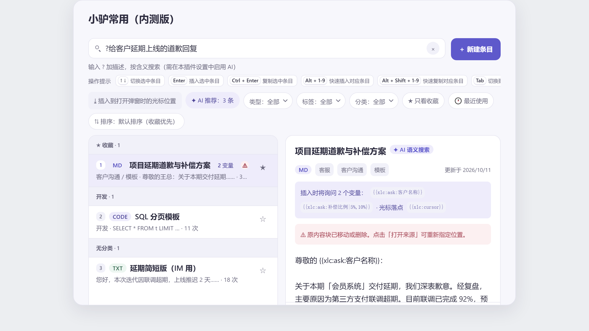

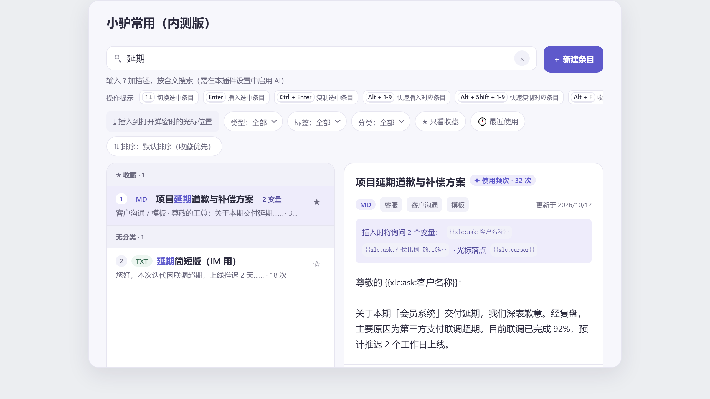

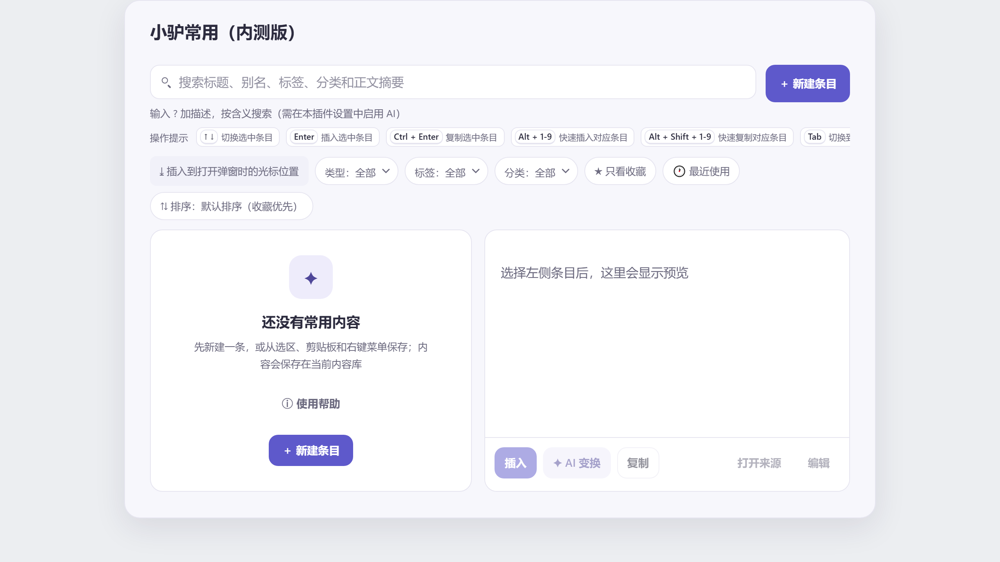

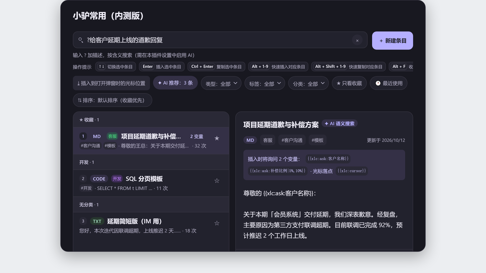

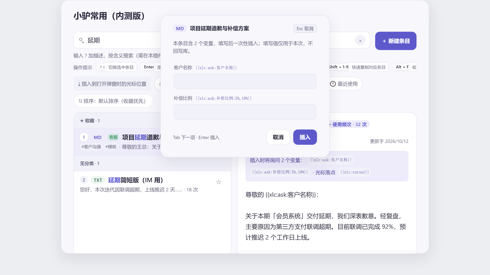

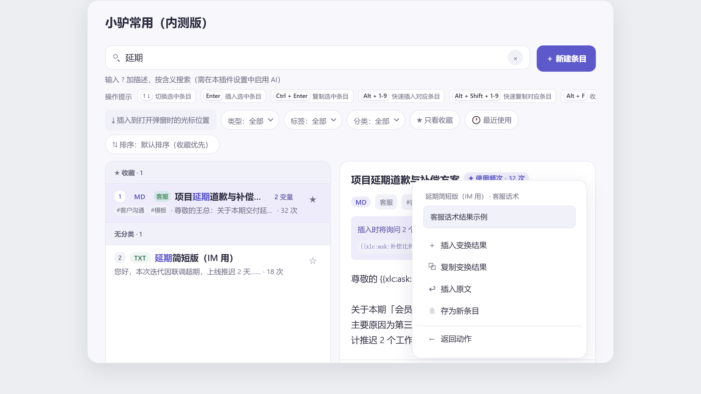

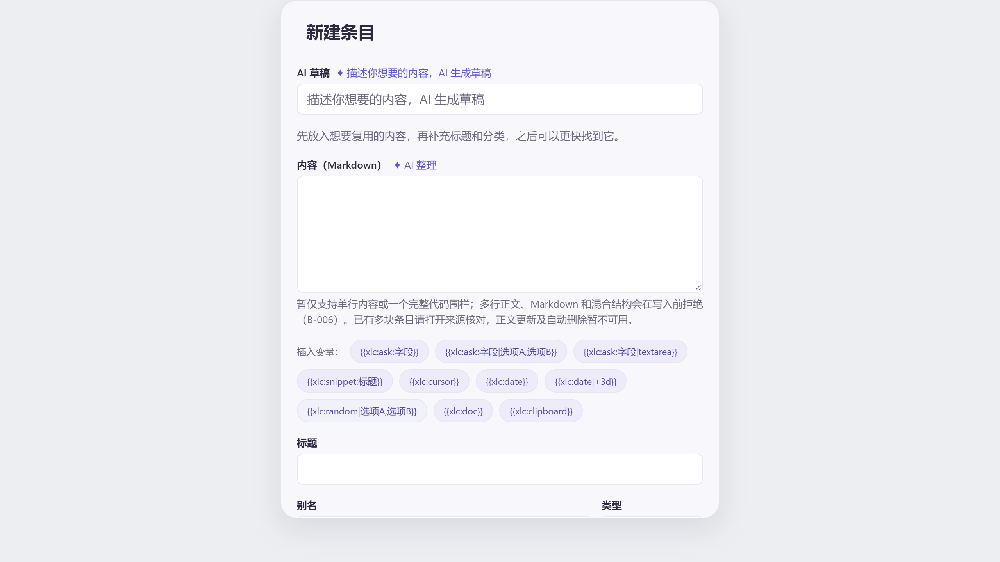

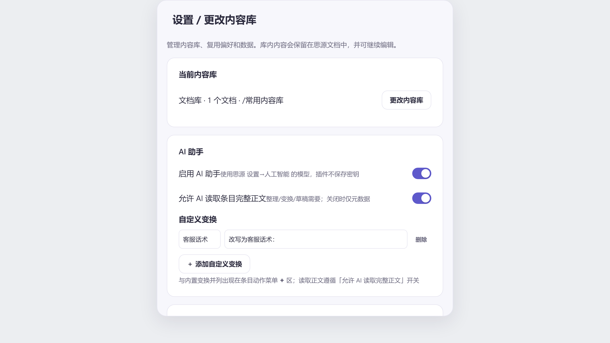

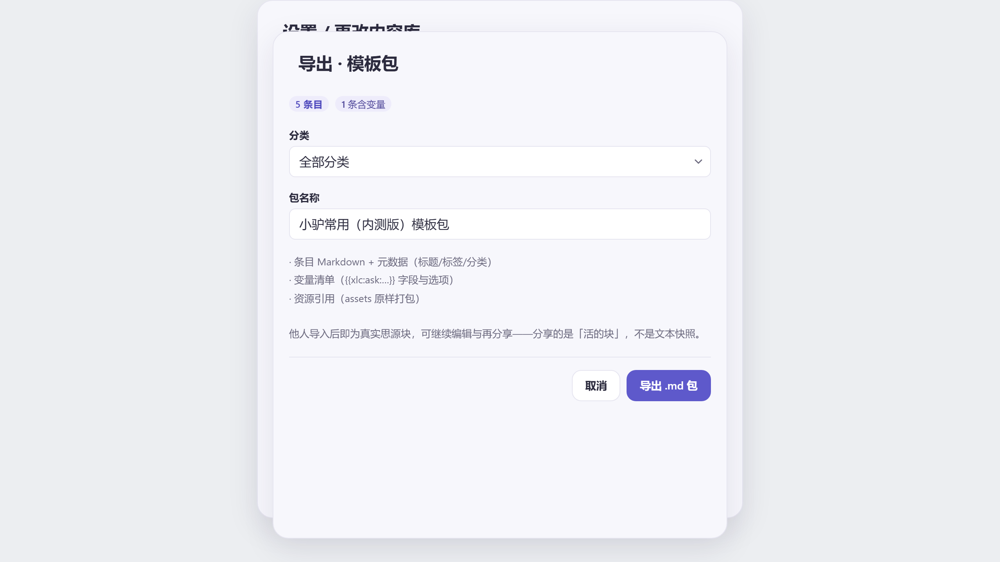


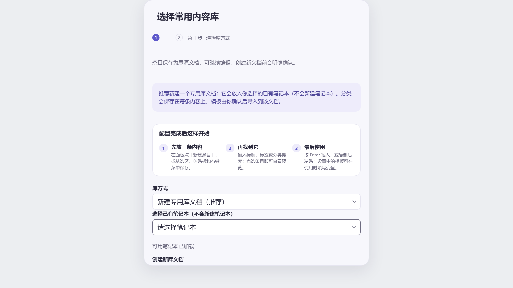

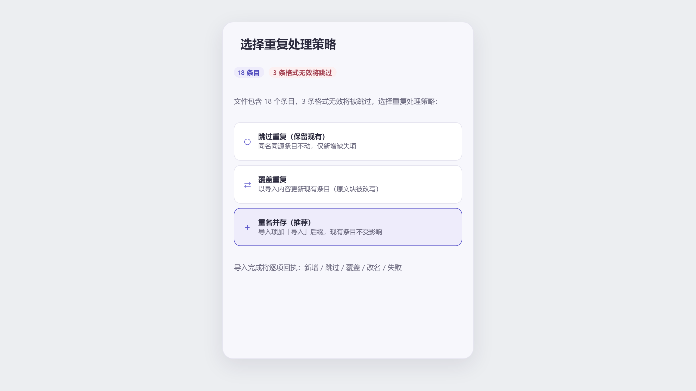

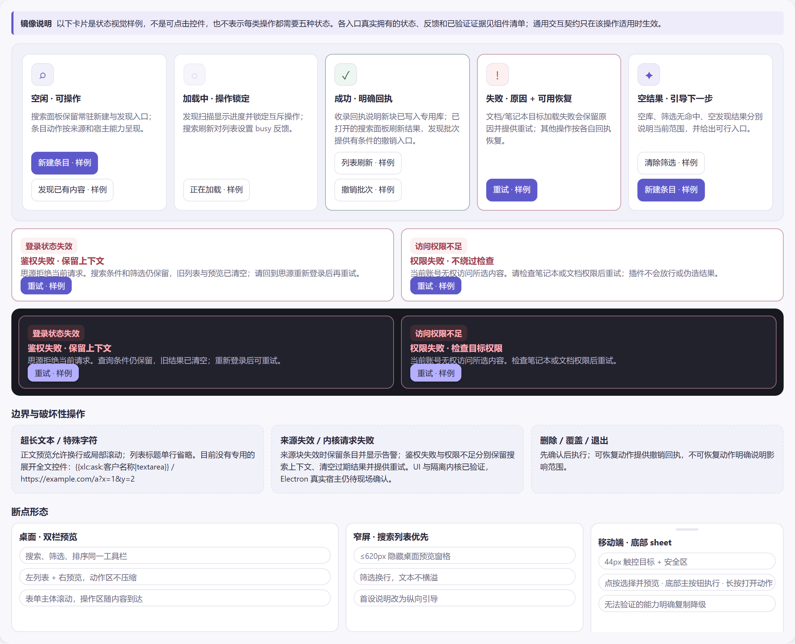


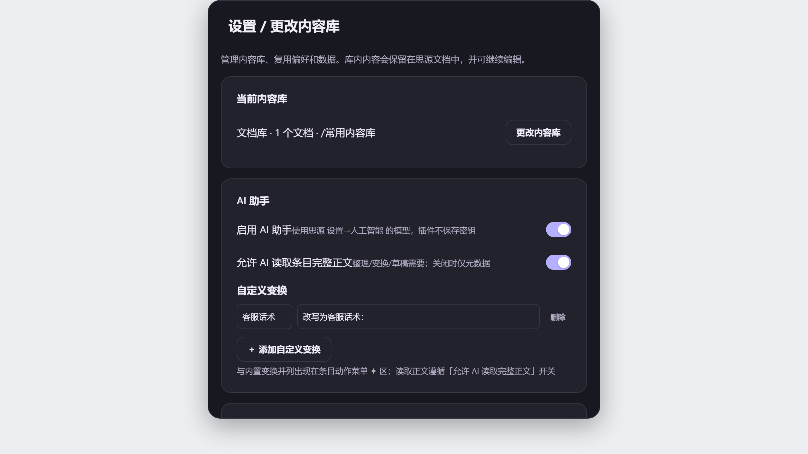

</details>

## 定位边界

**是**：思源内的常用内容保存与快速复用（搜索 → 预览 → 插入 / 复制 / 打开来源）。

**不是**：密码管理器、剪贴板历史、云同步服务、任意应用自动发送器、JS/SQL 执行器、雷切第二切换器、片段实验室管理器。

<details>
<summary>详细功能与数据说明（点击展开）</summary>

## 核心设计

1. **思源块 = 内容唯一真源**。每个条目是库文档中的一个真实块（普通块或 superblock 包装），插件不复制正文进私有库；删除插件，用户数据零损失。
2. **元数据走用户可见的块属性**（`custom-xlc-id/-type/-title/-alias/-tags/-category/-src-doc/-src-block/-url/-target/-created/-updated`），可在思源属性面板查看和手工修补。
3. **插件侧车（`data/storage/petal/xiaolv-common/`）只存**：库配置、收藏、最近使用、排序偏好、provider 注册——全部版本化、可重建、可迁移。
4. **不用 SQL**：遍历用 `getChildBlocks`（文档序），失效检测用 `checkBlocksExist`，内容用 `getBlockKramdown`（见 ADR 0003 的嵌入块边界说明）。
5. **诚实能力声明**：移动端直接插入、图片位图复制未真机验证前，自动降级为复制并明示「待验证」。

## 捕获入口（八种，覆盖全部右键上下文）

| 入口 | 捕获内容 |
| --- | --- |
| 选中文字 + ⌥⇧S / 右键菜单 | 选区文本（类型自动推断） |
| 右键当前块 / ⌥⇧B | 整块内容（kramdown 保真） |
| 右键块引用 | 被引用块 → blockref 条目 |
| 右键链接 | http(s) → URL 条目；assets/ → 附件条目 |
| 右键图片 | assets/ 图片 → 图片条目 |
| 右键文档树选中文档 | 一键设为常用库（confirm） |
| 剪贴板 / 命令 / 面包屑 / 顶栏 / 编辑器工具栏 | 各场景直达 |

## 数据模型

```
CommonItem（思源块承载）
├── id: "xlc-xxxx"            ← 稳定逻辑 ID（custom-xlc-id，跨工作区/导入导出不变）
├── blockId / libraryDocId    ← 物理定位（库文档中的锚定块）
├── itemType                  ← text|markdown|url|code|image|asset|blockref|structure
├── title / alias / tags / category
├── summary                   ← 有界摘要（≤240 字，内存索引缓存，可重建）
└── source                    ← sourceDocId / sourceBlockId / sourceType（回链）

侧车 state.json（v2）: favorites / recents / sort / uiPrefs / providers
库配置 config.json:    mode(doc|tree|notebook) + containerDocIds / notebookIds
```

## 插入语义（按类型分派）

| 类型 | 插入 | 复制 | 打开来源 |
| --- | --- | --- | --- |
| text | 段落文本 | 纯文本 | 来源文档/块 |
| markdown | 原样 kramdown | Markdown | 来源文档/块 |
| url | `[标题](url)` 链接 | 裸 URL | 外部浏览器（仅 http/https） |
| code | 代码块（保留语言） | 裸代码 | 来源文档/块 |
| image | `` 图片块 | Markdown 链接（位图复制待验证） | 资源预览 |
| asset | `[名](assets/…)` 链接块 | Markdown 链接 | 资源预览 |
| blockref | `((id '锚文本'))` 引用；另有插入源内容和嵌入动作 | 复制最新源内容（copy-content） | 目标块 |
| structure | 原样结构（superblock 剥壳） | Markdown | 来源文档/块 |

资源缺失时：插入/打开诚实失败，复制链接仍可用；来源块/文档删除显示「来源失效」。

## AI 能力（默认关，ADR 0005）

> 思源智能体已注册只读能力 `xiaolv_common_search`（按关键词搜条目，仅返回标题/类型/标签元数据，`localRead` 声明，不含正文）——在思源「设置→人工智能」的智能体中可直接调用。

使用你在思源 **设置→人工智能** 配置的模型，插件不保存任何密钥：

| 功能 | 入口 | 出域内容 |
| --- | --- | --- |
| **AI 整理** | 捕获表单「✦ AI 整理」→ 自动填标题/标签/分类建议，逐项采纳 | 条目正文（需开启「允许读取完整正文」） |
| **AI 草稿** | 新建表单描述一句话 → 生成模板草稿 | 描述文本（同上） |
| **AI 变换** | 动作菜单 ✦ 润色/缩短/正式化/译英/列表化 → 预览后选「插变换版/插原文」，**原文永不被改写** | 条目正文（同上） |
| **AI 语义找条目** | 搜索框 `?` 前缀（如 `?给客户的道歉回复`）→ 标注「AI 找到的」 | **仅元数据**（标题/别名/标签/分类/摘要），不含正文与来源 ID |
| **AI 标签体检** | 设置面板「✦ AI 标签体检」→ 归并/改名建议清单（只建议，不自动修改） | 仅标签清单 |

AI 整理或草稿生成失败时，表单会在对应操作旁保留错误原因并提供重试；重试使用当前正文或描述。自动化覆盖的是界面恢复流程，真实模型验收仍未完成。

另有**动态占位符**（code 条目保持字面，绝不改写代码）：条目中写 `{{xlc:date}} / {{xlc:time}} / {{xlc:datetime}} / {{xlc:weekday}} / {{xlc:title}} / {{xlc:doc}} / {{xlc:path}} / {{xlc:clipboard}}`，插入或复制时替换为当前日期时间/当前文档标题与路径/剪贴板文本（无活动文档等场景替换为空串）。**日期算术**：`{{xlc:date|+3d}}`（三天后）、`{{xlc:date|-1w}}`（一周前）、`{{xlc:date|+2m}}`/`{{xlc:date|+1y}}`（月/年进位按日历钳制）、`{{xlc:date|next_monday}}`（下一个星期一，取严格未来最近一天）。**随机选择**：`{{xlc:random|选项A,选项B,选项C}}` 替换时随机取一项。带参语法分隔符必须用 `|`（`:` 形式会被思源 emoji 短代码损坏，插件永不展开、保留原文）。表达式写坏一律原样保留不吞内容；`xlc:` 命名空间不误伤思源模板；存储内容始终保留模板原文，可在设置关闭。

## 变量、片段嵌套与模板包

| 能力 | 用法 |
| --- | --- |
| **插入时变量填充** | 内容写 `{{xlc:ask:字段}}`（文本）/ `{{xlc:ask:字段\|选项A,选项B}}`（下拉）/ `{{xlc:ask:字段\|date}}`（日期）/ `{{xlc:ask:字段\|textarea}}`（多行文本框，框内 Enter 换行、点按钮插入）→ 插入前弹填充卡片（Enter 插入 / Esc 取消 / Tab 切字段）；填写值仅用于本次不回写库；未填充兜底 `__字段__` 可见可改 |
| **光标落点** | `{{xlc:cursor}}` 标记位置（宿主 API 限制：插入后光标落于内容之后） |
| **片段嵌套** | `{{xlc:snippet:标题}}` 插入时展开为另一条目内容（深度 ≤3、环检测；不可解析落 `__片段：标题__`）；预览/填充卡所见 = 插入所得 |
| **常用排序** | 插入/复制自动记次数（仅本机、可清空）；排序档「⇅ 常用」= 次数 × 最近使用 |
| **模板包分享** | 设置 → 数据 → 「模板包」：按分类筛选、命名导出 `.md` 包（含变量清单）；导入方得到真实思源块——分享的是活的块，不是文本快照 |
| **导入 Espanso 配置** | 设置 → 数据 → 「从 Espanso 导入」：粘贴 Espanso match 配置（base.yml）全文，日期/剪贴板/随机变量与表单字段自动转为本库语法（`[[字段]]`→`{{xlc:ask:字段}}` 等），无等价映射的变量原样保留并逐条列出；同触发词重复导入走冲突策略。TextExpander 专有格式暂不支持 |
| **自定义 AI 变换** | 设置 → AI 助手 → 自定义变换（≤10 条）：你的指令与内置五种并列出现在动作菜单 ✦ 区 |
| **常用内容示例** | 设置 → 数据与模板 → 「导入常用内容示例」：内置 25 个模板（使用说明 / 地址 / 邮箱 / 无效身份占位 / 网址 / 代码入门 / 联系方式 / 客服回复 / AI 提示词 / 研发写作 / 开票资料 / 退换指引 / 催办 / FAQ），其中 8 条符合当前单行或完整代码围栏限制；照片、PPT、PDF/DOCX 和简历附件需先添加真实资源 |
| **快速捕获** | 命令「快速捕获剪贴板为条目」（默认 ⌥⇧V）：无表单一步入库、类型推断、同文自动跳过并提示 |

## 桌面搜索弹窗（调用中枢）

双栏（左列表右预览）/ 窄窗单列 / 移动端底部 sheet；桌面键盘 `↑↓ 选择 · Enter 插入 · Ctrl+Enter 复制 · Alt+1~9 直达 · Esc 关闭`；移动端点按条目只选择并更新预览，底部主按钮按目标执行插入或无目标时复制降级，长按打开动作；类型/标签/分类筛选、★收藏置顶、🕐最近、⇅排序、`?` 前缀 AI 语义找、提供方分区（其他小驴插件内容源）；条目显示类型徽标 / 变量徽标 / 使用次数 / 来源失效 ⚠。

## B-001 内核链路验收脚本

```bash
pnpm e2e:iso      # 仅内核验收：使用临时工作区和独立端口，结束后关闭测试内核
SIYUAN_ORIGIN=http://127.0.0.1:6806 SIYUAN_TOKEN=<你的令牌> pnpm e2e   # 对指定实例验收
```

脚本覆盖建库文档、追加条目与属性、回读/搜索/导出、更新和清理核验，逐项输出 ✔/✖ 与汇总。内核链路已有独立验收；Electron 的局部功能证据、整体隔离撤回与 B-005 停止条件见[已知限制](#known-limitations)。内核脚本不等于 Electron、真实 AI 或 Android 验收。

未配置模型/超时/空响应均诚实提示；总开关与正文出域开关在引导面板「AI 助手」区，任何输入下默认关闭（门禁测试锁定）。

## xiaolv-common/v1 协议

```js
// 其他插件（如雷切、打卡）通过 app.plugins 找到本插件实例：
const common = app.plugins.find(p => p.name === "xiaolv-common");
await common.service.search({text: "客服", itemType: "", tag: "", scope: "all"});
await common.service.insert(itemId, {mode: "insert"});   // insert|insert-content|copy|copy-content|insert-ref|insert-embed|open
await common.service.copy(itemId);
await common.service.openSource(itemId);
common.registerProvider({protocol: "xiaolv-common", protocolVersion: 1, pluginId: "xiaolv-checkin", displayName: "小驴打卡"});
common.protocolCommands["xiaolv.common.open"]();          // 稳定命令 ID
```

- 服务接口：`getCapabilities / search / get / save / update / remove / insert / copy / openSource / reindex / getRecent / getFavorites`
- 命令 ID：`xiaolv.common.open / saveSelection / insert / copy / openSource`；发现协议另有 `discoverCurrentDocument / discoverCurrentNotebook / previewDiscoveryCandidate / addDiscoveryCandidate / closeDiscoverySession / beginDiscoveryBatch / finishDiscoveryBatch / undoDiscoveryBatch`；指定树、指定笔记本和全部笔记本可从发现面板选择；接入示例见 [docs/provider-guide.md](docs/provider-guide.md)
- 事件（window CustomEvent，detail 带 protocolVersion）：`xiaolv:common:item-created / item-updated / item-deleted / item-inserted`
- 兼容行为：未知字段保留透传；未知能力忽略；更高主版本明确拒绝（不静默降级）。

</details>

<a id="install"></a>
## 安装、升级与备份

- **安装**：集市（待上架）或手动——把 `package.zip` 解压到 `<工作空间>/data/plugins/xiaolv-common/`，重启思源并在「设置 → 集市 → 下载」中启用。启用后可在命令面板搜索「打开小驴常用（内测版）」或点击顶栏图标进入；若侧车设置读取失败，插件仍会保留这些入口并提示原因。
- **首次使用**：点击顶栏图标，按引导选择库。默认推荐在已有笔记本中新建「常用内容库」文档；也可选已有文档、文档树或按笔记本。创建前会显示确认信息，模板需要你在设置中确认导入；分类作为条目属性写入当前内容库文档。之后可在插件设置 → 当前内容库中更改模式和落点。
- **升级**：覆盖插件目录后重启；侧车 schema 自动迁移（v1→v2）；未来版本数据只读保留不降级改写。
- **备份**：库内容 = 普通思源文档，随思源同步走；导出 JSON（含全部条目与来源引用）或 **Markdown 包 ZIP**（items.md + assets/ 资源，无依赖解压即读）；恢复 = 导入 JSON 或 **Markdown 包**（自动识别文件类型，同一套校验/冲突策略/回执）；Markdown 包可被任何文本工具阅读。
- **卸载**：不删除库文档与块属性；侧车目录由思源清理。

## 开发

```bash
pnpm i
pnpm run check:errors  # 异常回执安全门禁
pnpm run check   # tsc --noEmit
pnpm test        # 单元测试
pnpm run build   # dist/ + package.zip
node scripts/render-prototype.cjs    # 原型图截图（需 Playwright Chromium）
pnpm run test:ui                # 生产界面 smoke 与截图（需 Playwright Chromium）
```

系列协议见 [AGENTS.md](AGENTS.md)；路线见 [ROADMAP.md](ROADMAP.md)；阻塞见 [BLOCKERS.md](BLOCKERS.md)；取舍见 [docs/adr/](docs/adr/)；宿主 API 能力矩阵见 [docs/host-contract.md](docs/host-contract.md)。实现镜像原型见 [docs/design/prototype.html](docs/design/prototype.html)，组件清单见 [docs/ui-component-catalog.md](docs/ui-component-catalog.md)，从零运行、脚本和部署见 [docs/delivery.md](docs/delivery.md)。

<a id="known-limitations"></a>
## 已知限制

- **宿主证据有边界**：独立内核核心与发现链路已通过；思源 3.8.7 / Electron 44.7.0 仅保留已覆盖动作的局部功能观测。测试镜像额外打开日常工作区并触发云同步，影响尚未确定，整体隔离声明已撤回；B-005 开放，后续 Electron 实验停止。进程检查不能替代操作系统层隔离，见[事故记录](https://github.com/ai68298100/xiaolv-common/blob/v0.4.2/docs/electron-isolation-incident-2026-10-16.md)和[阻塞清单](https://github.com/ai68298100/xiaolv-common/blob/v0.4.2/BLOCKERS.md)。
- 真实 AI、Android 触控与图片位图剪贴板尚未验证。移动端无定向目标时复制降级，有定向目标时走插入路径但仍待真机验证；图片位图复制降级为 Markdown 链接。同一编辑器连续引用/嵌入后可能因选区失效而明确降级复制。B-004 设置异常未定位，有限压力样本未复现不等于已修复。
- 保存视图支持文档、当前笔记本和文档树，最多 20 条；指定笔记本/全部笔记本可手动发现，暂不能保存为视图。同步由用户触发，不做后台自动收录；旧笔记本规则缺少固定目标时需重新保存。
- 拼音搜索：已接入 tiny-pinyin（本地注解，设置可关，ADR 0004/R5），并纠正常见多音词；词表并非完整多音字词典。
- 库文档树模式从根文档最多展开 3 层子文档；条目索引上限 2000（超出截断并明示，数据仍安全在库中）。
- 导入冲突按逻辑 ID 判定（无内容级 diff）。
- 「选择现有文档」支持通过宿主公开文档搜索 API 按关键词选择；部分宿主兼容与真实 AI、Android 验收继续按 B-001/B-002 跟踪。
